# enterprise-network-lab

\## DHCP

I set up DHCP on both domain controllers and configured failover between them, so address leasing keeps working if one server goes down.

\### Design

\* Scope: 192.168.100.100 to 192.168.100.200 on the 192.168.100.0/24 network

\* Server addresses (.10 and .11) sit outside the scope so they never get handed out

\* Options given to clients: default gateway, both DNS servers (DC01 and DC2), and the lab.local domain name

\* Both servers are authorized in Active Directory

\### Failover

\* Mode: hot standby

\* DC01 is the active server and DC2 is the standby

\* The two servers share the scope settings and the list of leased addresses, so DC2 can continue from where DC01 stopped

\* I chose hot standby because my host only has 16 GB of RAM, so DC2 does not need to run all the time

\### Problems I hit and how I fixed them

\* A mistyped authorization command created a wrong entry (DC01 name with DC2's IP). I found it with Get-DhcpServerInDC and removed it with Remove-DhcpServerInDC.

\* The scope was missing the router option and listed only one DNS server. I corrected both so clients would still resolve names when DC01 is offline.

   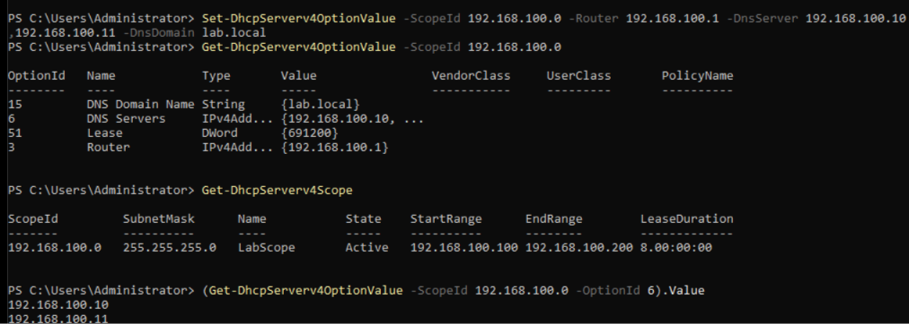
   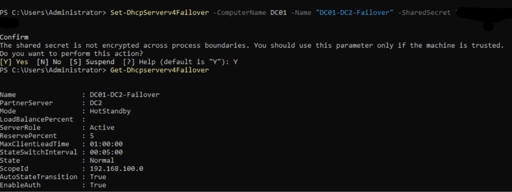
   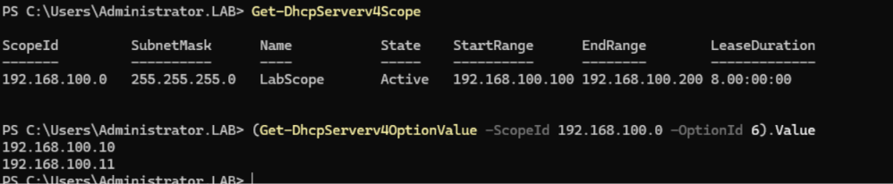

## Failover test

I tested the DHCP failover by shutting down DC01 while DC2 stayed on.

* DC2 moved to PartnerDown and kept serving the network
* When DC01 came back it stayed in RecoverWait for one hour, which is the Maximum Client Lead Time. This stops the two servers handing out the same address.
* After the hour, both servers returned to Normal

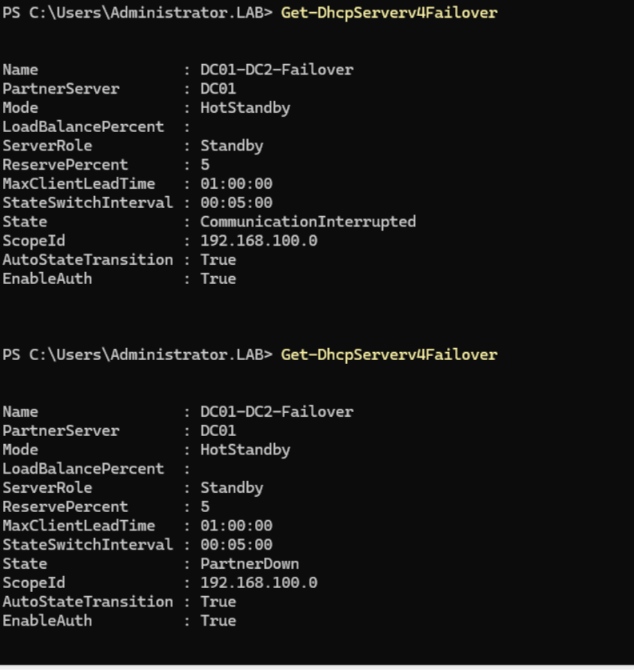
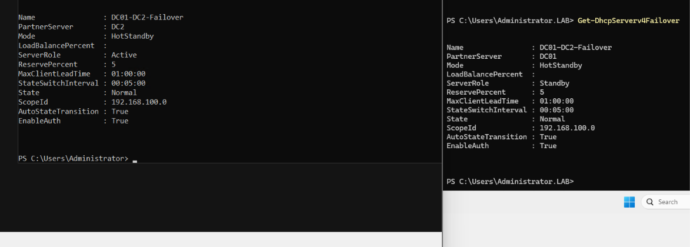

## GNS3 VM
* GNS3 VM runs on Hyper-V on DevOps-Internal-Switch at 192.168.100.30
* Nested virtualization enabled so QEMU based devices run (KVM support: True)
* Static IP used so the GNS3 client always finds the server

## First GNS3 topology

I connected a GNS3 topology to the lab network through a Cloud node bound to the GNS3 VM's eth0, which sits on DevOps-Internal-Switch.

* Topology: Cloud node, Ethernet switch, one VPCS test PC
* The VPCS requested an address with "ip dhcp" and received a lease from the DHCP server on DC2
* I confirmed the lease on the server with Get-DhcpServerv4Lease

### Problems I hit and how I fixed them
* Hyper-V drops frames from unknown MAC addresses, so I enabled MAC address spoofing on the GNS3 VM adapter.
* The host reached 95% RAM, so I shut down unused VMs before building.

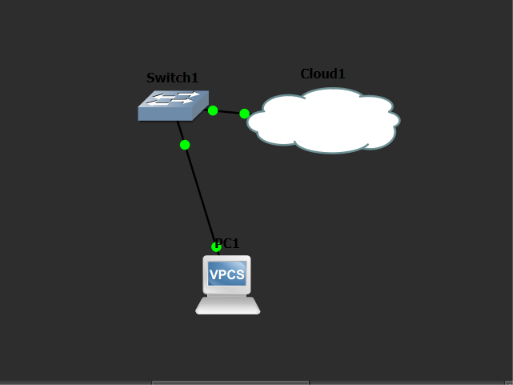
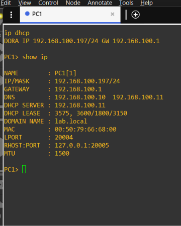

## Images and appliances
* Imported Cisco 7200 routers (Dynamips), MikroTik CHR and Alpine Linux into GNS3
* The GNS3 VM has a second adapter on the Default Switch so it can download appliances, while lab traffic stays on the isolated internal switch
* Images are not stored in this repo (excluded with .gitignore)

## Department VLANs and DHCP

I split the lab network into one VLAN per department and made R1 route between them. DHCP is relayed from R1 to the servers, so each department gets addresses from its own scope.

### Design

| VLAN | Department | Subnet | Gateway (R1) |
|---|---|---|---|
| 10 | Finance | 192.168.10.0/24 | 192.168.10.1 |
| 20 | HR | 192.168.20.0/24 | 192.168.20.1 |
| 30 | IT | 192.168.30.0/24 | 192.168.30.1 |
| 99 | Management | 192.168.99.0/24 | 192.168.99.1 |
| None | Servers | 192.168.100.0/24 | 192.168.100.254 |

* R1 (Cisco 7200) does inter VLAN routing using subinterfaces on one trunk link (router on a stick)
* SW-ACCESS1 (MikroTik CHR) is the access switch, with a trunk to R1 and one access port per department
* Each Alpine Linux test PC sits on an access port in its own VLAN
* R1 relays DHCP requests to both domain controllers (DC2 and DC01) using ip helper-address
* DC2 has one DHCP scope per department, with the VLAN gateway, both DNS servers and the lab.local domain name as options
* The Servers network now uses R1 as its gateway, so DC2 can reply to every VLAN

### Test results
* Alpine1 (Finance) received an address from the 192.168.10.0 scope
* Alpine2 (HR) received an address from the 192.168.20.0 scope
* Alpine3 (IT) received an address from the 192.168.30.0 scope
* Each client could ping its gateway on R1 and the DHCP server on DC2

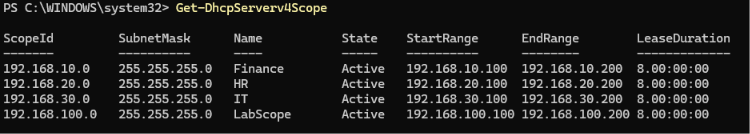
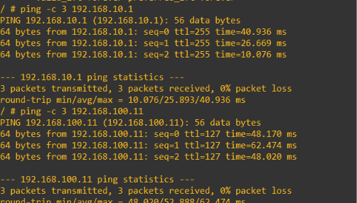
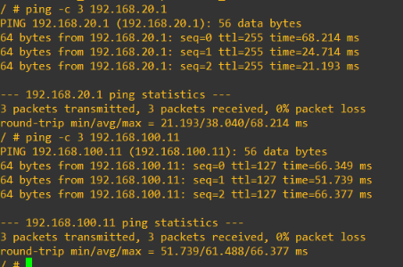
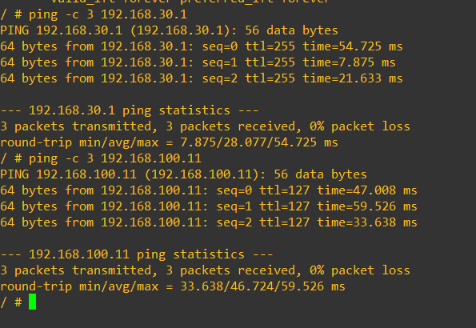

### Problems I hit and how I fixed them
* After a restart, GNS3 said it could not find the GNS3 VM. Hyper-V only shows its VMs to administrators, so I ran GNS3 as administrator.
* The Cloud node was lost after the restart, so I rebuilt it and bound it to eth0 only.
* The DHCP replies from DC2 would not have reached the new VLANs while its default gateway pointed at my host PC. I changed the gateway to R1.

### Not done yet
* The new scopes still need to be added to the DHCP failover relationship between DC01 and DC2
* ACLs between VLANs, so departments cannot reach each other
* Redundancy, QoS and 802.1X authentication