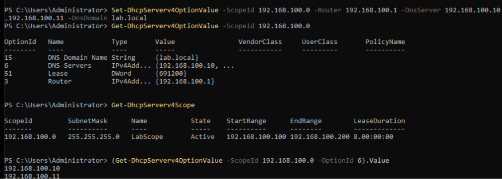
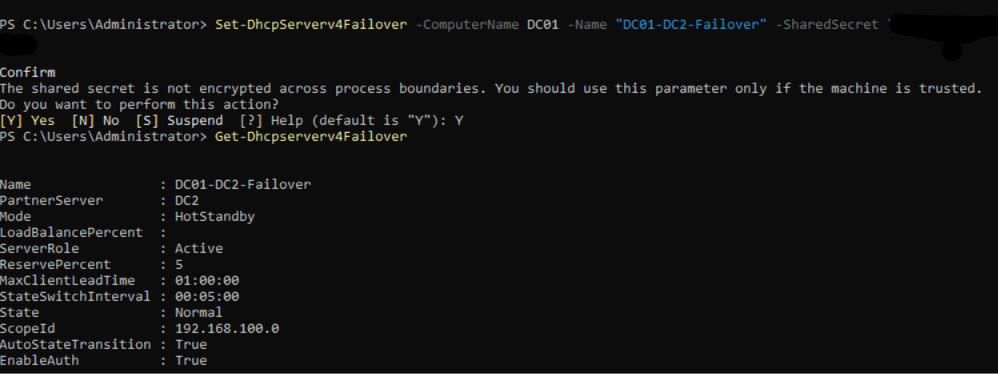
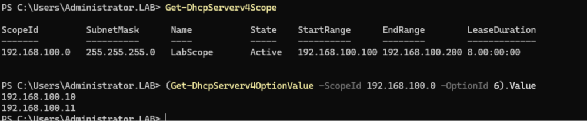
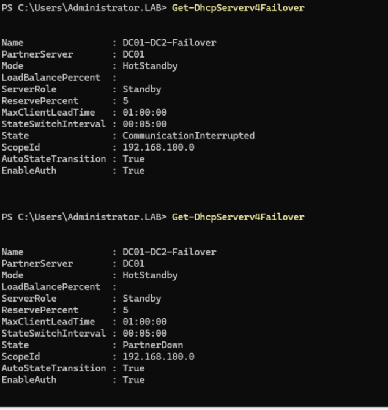
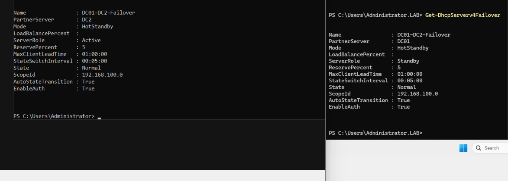

# enterprise-network-lab

\## DHCP

I set up DHCP on both domain controllers and configured failover between them, so address leasing keeps working if one server goes down.

\### Design

\* Scope: 192.168.100.100 to 192.168.100.200 on the 192.168.100.0/24 network

\* Server addresses (.10 and .11) sit outside the scope so they never get handed out

\* Options given to clients: default gateway, both DNS servers (DC01 and DC2), and the lab.local domain name

\* Both servers are authorized in Active Directory

\### Failover

\* Mode: hot standby

\* DC01 is the active server and DC2 is the standby

\* The two servers share the scope settings and the list of leased addresses, so DC2 can continue from where DC01 stopped

\* I chose hot standby because my host only has 16 GB of RAM, so DC2 does not need to run all the time

\### Problems I hit and how I fixed them

\* A mistyped authorization command created a wrong entry (DC01 name with DC2's IP). I found it with Get-DhcpServerInDC and removed it with Remove-DhcpServerInDC.

\* The scope was missing the router option and listed only one DNS server. I corrected both so clients would still resolve names when DC01 is offline.

   
   
   

## Failover test

I tested the DHCP failover by shutting down DC01 while DC2 stayed on.

* DC2 moved to PartnerDown and kept serving the network
* When DC01 came back it stayed in RecoverWait for one hour, which is the Maximum Client Lead Time. This stops the two servers handing out the same address.
* After the hour, both servers returned to Normal

